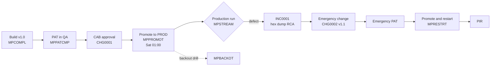

<div align="center">

# 🍁 Maple Host Release Lab

**Mainframe change and release management on real IBM z/OS: COBOL, JCL, PAT testing, Db2 reconciliation and ServiceNow change control**

[](https://github.com/jamierowe15/maple-host-release-lab/actions/workflows/cobol-build.yml)
[](#-results)
[](#-repository-layout)
[](change/)
[](LICENSE)

### [📘 Lab guide](LAB-GUIDE.md) · [🧾 Run evidence](evidence/auto-run/AUTO-RUN-SUMMARY.md) · [🔐 SOX control matrix](controls/SOX-CONTROL-MATRIX.md) · [📝 PIR](change/PIR-CHG0002.md)

</div>

---

A hands-on **mainframe change and release management lab**. A COBOL batch program goes from build through PAT testing, change approval, an overnight production deployment, a production defect, an emergency fix, a step restart and a post-implementation review. The mainframe work runs on real IBM z/OS through **IBM Z Xplore**, and the change management runs in a **ServiceNow** developer instance.

> *Maple is a fictional bank. No real bank systems, data or procedures are used.*

## 📑 Contents
- [The scenario](#-the-scenario)
- [Release flow](#-release-flow)
- [Skills demonstrated](#-skills-demonstrated)
- [Repository layout](#-repository-layout)
- [Build gate](#-build-gate)
- [Results](#-results)
- [Related labs](#-related-labs)

## 🎬 The scenario

The HOST delivery team is releasing **MPINTCLC**, a nightly COBOL batch that calculates daily interest by account, writes a report and a reject file, and produces control totals.

1. **v1.0** is built in DEV, PAT-tested in QA against a signed-off baseline, approved through CAB (**CHG0001**) and deployed in a Saturday 01:00 window.
2. On its first production run, a record with a blank balance triggers a production defect (the scenario is designed around an **S0C7 abend**; see [Results](#-results) for what actually happened on Z Xplore).
3. The issue goes through an incident (**INC0001**), root cause in a hex dump, an **emergency change** (**CHG0002**, v1.1), an emergency PAT, promotion, a **restart from the failed step** and a PIR.

## 🔄 Release flow



## 🧩 Skills demonstrated

| Area | Where in the lab | Level |
|---|---|---|
| PAT environment testing | `MPPATCMP` (SuperC against signed-off baselines in QA), CI regression suite | **Hands-on** |
| Change creation and coordination | CHG0001 Normal + CHG0002 Emergency in ServiceNow, CAB/ECAB approvals | **Hands-on** |
| Deployment and release management | `MPPROMOT` DEV → QA → PROD, backup before every move, `MPBACKOT` backout drill | **Hands-on** |
| SOX audit controls and change procedures | [`controls/SOX-CONTROL-MATRIX.md`](controls/SOX-CONTROL-MATRIX.md), segregation of duties, evidence log | **Hands-on** |
| Overnight/weekend deployment support | Deployment run in a scheduled Sat 01:00–03:00 window | **Hands-on** (simulated window) |
| JCL | 8 jobs: allocation, data load, compile, batch stream with IF/THEN, PAT compare, promote, backout, restart | **Hands-on** |
| COBOL | [`src/cobol/MPINTCLC.cbl`](src/cobol/MPINTCLC.cbl): validation, packed-decimal maths, control totals, return codes | **Hands-on** |
| ISPF | 3.4 data set lists, column-limited FIND, editing source, HEX browse for root cause | **Hands-on** |
| Db2 | Control-total reconciliation SQL ([`db2/`](db2/)) | **Hands-on** |
| ServiceNow | Change, incident, CMDB CI, approvals | **Hands-on** |
| CA 7 | Job network model + a working predecessor/successor trigger through the internal reader | **Modeled** (CA 7 is licensed) |
| CA 11 | Restart runbook + practised `RESTART=` step restart with cleanup rules | **Modeled** (CA 11 is licensed) |
| Endevor | Stage/promotion model mapped to libraries, IEBCOPY moves, approvals and tags | **Modeled** (Endevor is licensed) |
| IMS | [`ops/IMS-PRIMER.md`](ops/IMS-PRIMER.md) | Concept |
| Network technology | Port testing, Wireshark TLS capture, delivery network touchpoints | **Hands-on** |
| Mainframe + Tandem workload | [`ops/TANDEM-PRIMER.md`](ops/TANDEM-PRIMER.md) | Concept |
| Communicate, escalate, resolve | Incident stakeholder update, timeline, PIR actions | **Hands-on** |

## 📂 Repository layout

```
src/cobol/      MPINTCLC.cbl (v1.1; CHG0002 lines tagged in columns 73-80)
src/jcl/        MPALLOC MPLOAD MPCOMPL MPSTREAM MPRESTRT MPPATCMP MPPROMOT MPBACKOT
data/           test + production input, signed-off expected results
db2/            reconciliation table, rows and queries
scheduling/     CA 7 job network, CA 11 restart runbook
endevor/        promotion model
change/         ServiceNow setup, CHG0001, INC0001, CHG0002, PIR
controls/       SOX control matrix, evidence log
ops/            network touchpoints, IMS and Tandem primers
scripts/        local GnuCOBOL build + regression, data-load JCL generator
evidence/       job logs from the real runs, screenshots
PUBLISH-TO-GITHUB.cmd   one-click publish (double-click on Windows)
GIT-STEP-BY-STEP.md     the same process by hand, plus the daily lab Git workflow
```

Start with **[LAB-GUIDE.md](LAB-GUIDE.md)**.

## ✅ Build gate

Every push compiles the program with **GnuCOBOL** and checks it against the signed-off expected results ([`.github/workflows/cobol-build.yml`](.github/workflows/cobol-build.yml)). Run it locally in WSL or Linux:

```bash
scripts/local-build.sh v1.1 PRODDATA
```

## 📊 Results

*Run on IBM Z Xplore, 2026-11-23.*

| Check | Outcome |
|---|---|
| All jobs on real z/OS | ✅ Full job logs and a step-by-step table in [`evidence/auto-run`](evidence/auto-run/AUTO-RUN-SUMMARY.md) |
| PAT: QA v1.0 vs V10TEST | ✅ CC 0000 |
| Production verification | ✅ CC 0000 |
| Emergency PAT: v1.1 vs V11PROD | ✅ CC 0000 |
| Backout drill PAT | ✅ CC 0000 |

**What the production defect actually looked like:** with this system's COBOL settings, v1.0 did **not** abend. It accepted a blank balance as 0.00 for account 1000100010 and ended **RC 4**, with totals that still balanced ([screenshot](evidence/D5-v10-wrong-balance.png)). v1.1 rejects the record as `BALANCE NOT NUMERIC`.

**Detection lesson:** the [Ops Automation Lab](https://github.com/jamierowe15/maple-ops-automation-lab)'s message monitor classed the run as RC 4 / NOTIFY. Only the PAT comparison against a signed-off baseline exposed the data defect.

**IBM Z Xplore:** VSC1 complete; Fundamentals badge in progress.

<!-- ServiceNow records: to be added -->

## 🔗 Related labs

| Lab | Focus |
|---|---|
| [Maple Ops Automation Lab](https://github.com/jamierowe15/maple-ops-automation-lab) | REXX message monitor, auto-recovery and DR runbook on z/OS; detects this lab's production run |
| [Fort Charles PAM Lab](https://github.com/jamierowe15/fort-charles-pam-lab) | PowerShell privileged access management lab modelled on CyberArk PAS |

---

<div align="center">

**Jamie Rowe** · [github.com/jamierowe15](https://github.com/jamierowe15) · Toronto, ON

*Maple is fictional. CA 7, CA 11, Endevor, IMS and ServiceNow are trademarks of their owners; licensed products are modelled where noted.*

</div>
